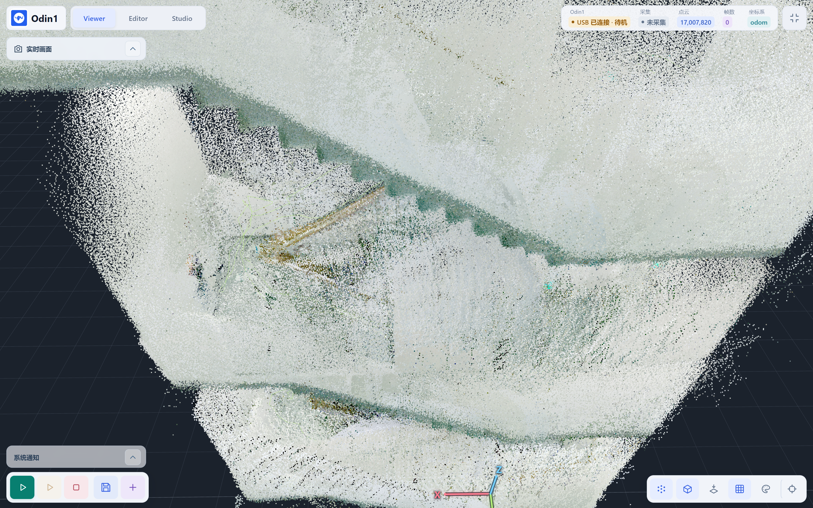
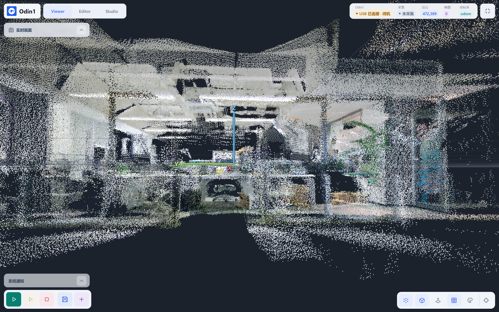
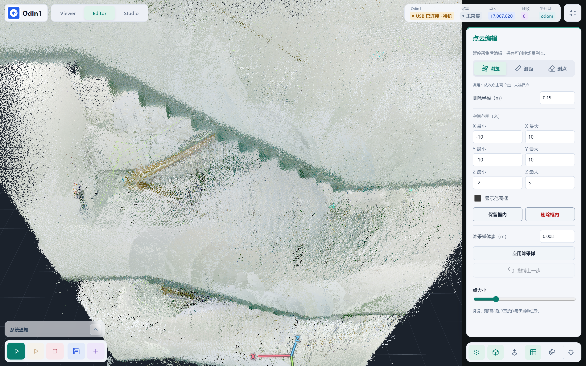
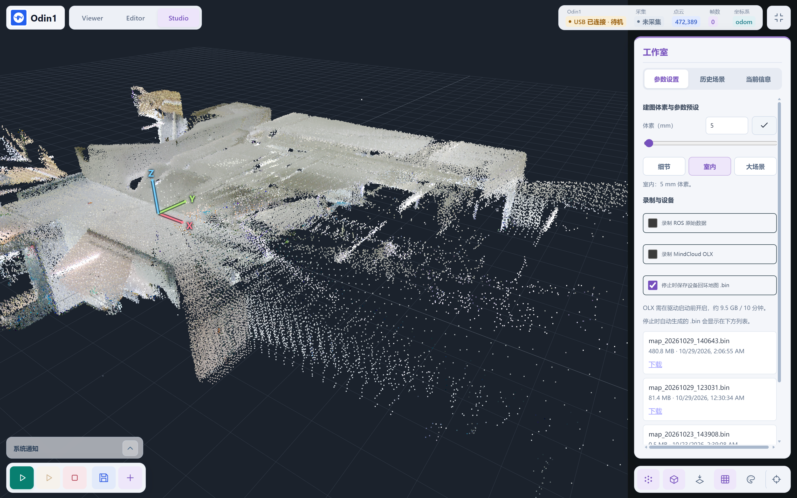
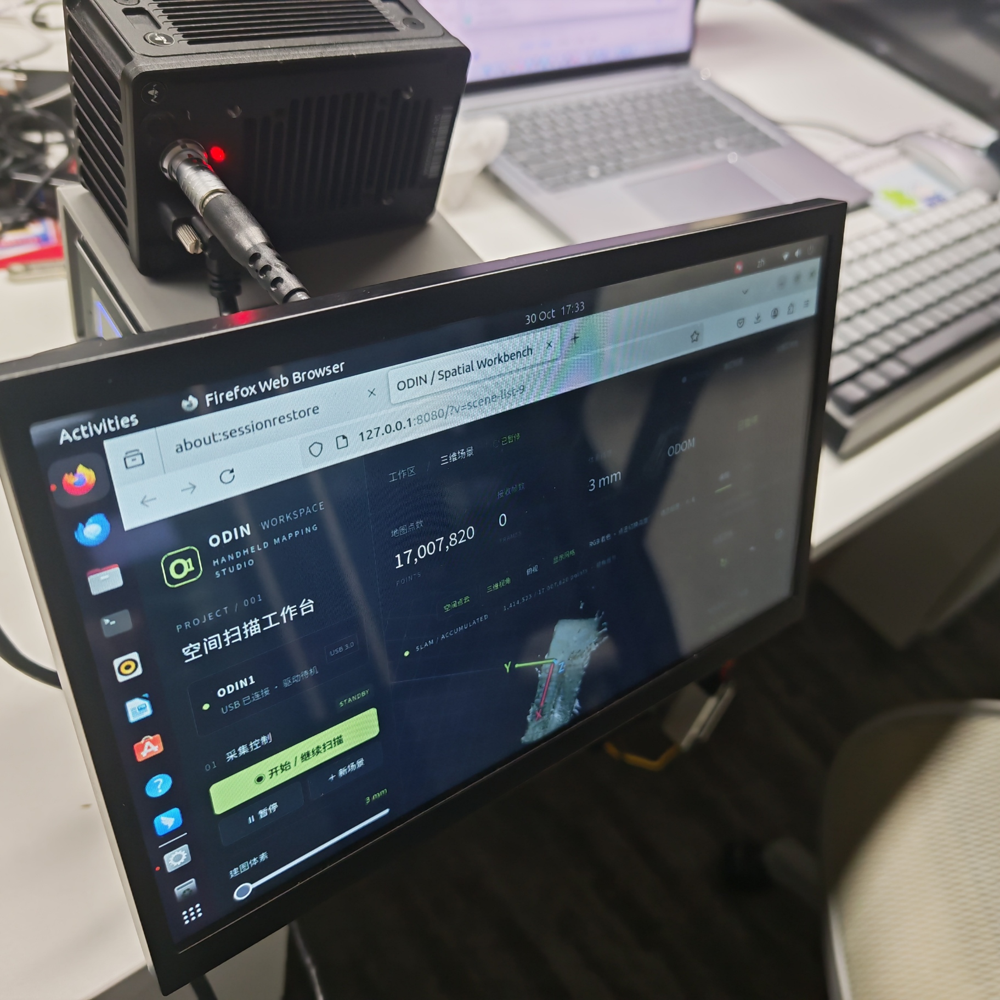
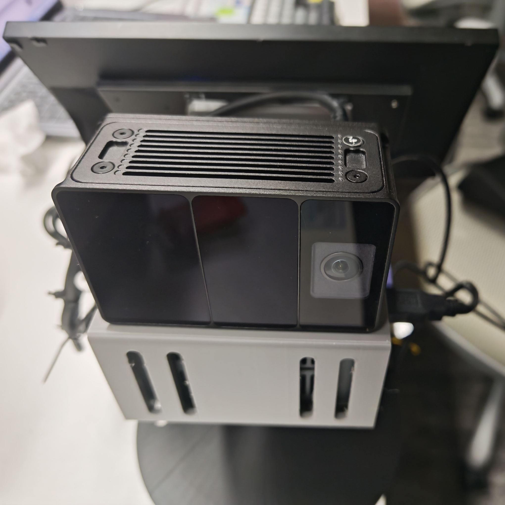
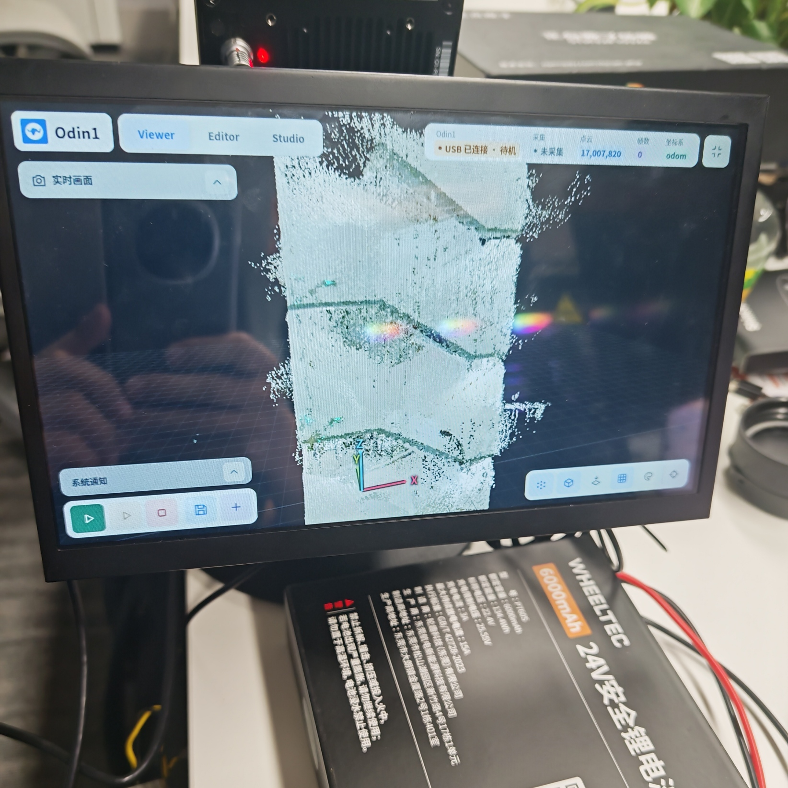
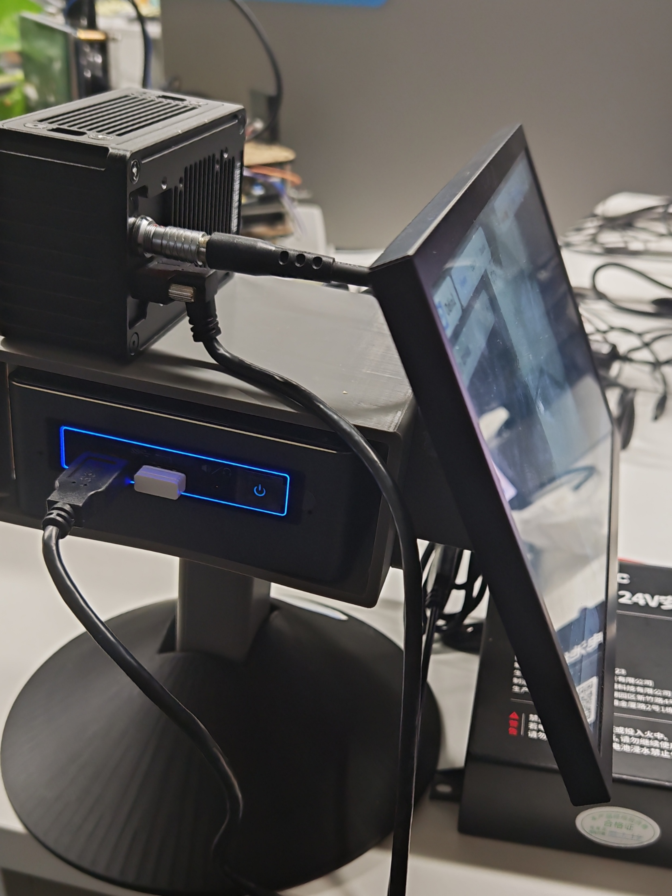

# Odin1 Mapping Workbench

面向 Odin1 手持设备的本地建图 WebApp，基于 ROS 2 Humble、Python/aiohttp 和 Three.js，提供实时彩色点云查看、采集控制、场景编辑、数据保存及设备回环地图导出。

项目使用 **Odin1 设备内置 SLAM**，官方驱动负责设备通信与 ROS 消息发布，上位机负责数据管理和可视化。设备 SLAM 与 SDK 的内部算法不属于本项目的开源实现。

## 项目展示

以下为实际设备、浏览器界面与扫描点云的展示素材。截图包含历史场景查看状态，点云总数不代表当前正在采集，也不作为测量精度或实时性能的评测结果。部分素材录制于双页面拆分之前，具体操作入口以当前版本为准。

### 三维点云效果



### Viewer / Editor / Studio

| Viewer：室内点云浏览 | Editor：点云编辑 |
| --- | --- |
|  |  |



### 视频演示

四段原始录屏按提供顺序保留，点击链接打开对应 MP4 文件；若仓库页面未提供播放预览，可下载后播放。

| 演示 | 视频文件 | 大小（约） |
| --- | --- | --- |
| 三维展示 1 | [观看 / 下载视频](docs/media/demo-01.mp4) | 16.3 MiB |
| 三维展示 2 | [观看 / 下载视频](docs/media/demo-02.mp4) | 8.7 MiB |
| 三维展示 3 | [观看 / 下载视频](docs/media/demo-03.mp4) | 5.4 MiB |
| 三维展示 4 | [观看 / 下载视频](docs/media/demo-04.mp4) | 27.2 MiB |

### 实物与部署

| 主控与显示屏部署 | Odin1 设备正面 |
| --- | --- |
|  |  |

<details>
<summary>更多实物照片：显示效果与设备连接</summary>

| 显示屏上的点云效果 | 设备、主控与显示屏连接 |
| --- | --- |
|  |  |

</details>

素材目录为 `docs/media/`，引用使用仓库相对路径。上传仓库时请一并保留此目录；演示视频未作剪辑，截图与照片未作内容修改。

## 目录

- [项目展示](#项目展示)
- [功能与边界](#功能与边界)
- [系统架构](#系统架构)
- [环境要求](#环境要求)
- [安装与构建](#安装与构建)
- [启动与访问](#启动与访问)
- [操作流程](#操作流程)
- [数据与坐标系](#数据与坐标系)
- [配置](#配置)
- [HTTP 与 WebSocket 接口](#http-与-websocket-接口)
- [源码结构](#源码结构)
- [测试与排查](#测试与排查)
- [GitHub 发布准备](#github-发布准备)

## 功能与边界

| 功能 | 说明 |
| --- | --- |
| 独立工作台 | `/workbench`：铺满窗口的 Viewer、Editor、Studio 界面，适合触摸屏操作 |
| 完整功能界面 | `/console`：侧栏、指标、场景工具等完整布局 |
| 实时点云 | 空间分块加载、视锥筛选、渐进 LOD、RGB/高度着色、网格与视角切换 |
| 采集控制 | 开始、暂停/继续、停止、新建场景 |
| 点云编辑 | 测距、球形删点、范围裁剪/删除、区域降采样、最近三步撤销 |
| 场景保存 | SQLite 快照、完整点云 PLY/PCD/NPZ 和元数据，历史场景加载与下载 |
| 设备地图 | 默认在停止驱动前请求生成 `.bin` 回环地图，完成后显示下载列表 |
| 原始录制 | ROS 2 bag 与 MindCloud OLX 两条独立录制链路 |
| 状态显示 | USB、驱动、SLAM 数据、采集状态、点数、接收帧数、坐标系及通知 |
| 实时画面 | 工作台中的相机预览，依赖设备发布压缩图像 |

应用未设置固定地图点数上限，实际容量取决于主控磁盘、内存、处理能力与浏览器资源。采集体素代表采样密度，**不等于设备测量精度**。

网页累计点云位于 `odom` 坐标系，不会对全部历史点执行设备回环优化后的形变更新。因此，网页点云与设备最终回环地图 `.bin` 是不同产物。现有点云不能通过修改扩展名获得设备地图，也不能补生成未录制的 OLX 原始数据。

代码保留表面重建和高斯重建实验模块；默认主流程为点云建图。实验模块需要额外依赖与单独验收，不作为基础安装成功的判据。

## 系统架构

```text
Odin1（设备内置 SLAM）
  └─ USB 3.0 → 官方 odin_ros_driver
       ├─ 点云 / 里程计 / IMU / TF / 图像 → ROS 2 bridge
       │    └─ Python Web 服务
       │         ├─ SQLite 空间页、采集去重、编辑与撤销
       │         ├─ HTTP：状态、分块点云、场景与文件下载
       │         └─ WebSocket：实时状态推送
       │              └─ Three.js 浏览器查看器
       ├─ SaveMap 服务 → 设备生成并传输 .bin
       └─ recorddata → MindCloud OLX 数据目录
```

地图原始点和体素索引保存到 SQLite/WAL。点页按空间块组织，每页最多 32768 点；浏览器根据视角请求不同层级的点云，并释放视野外几何数据。显示 LOD 不修改原始地图或完整导出文件。

## 环境要求

- 主控：Ubuntu 22.04、Python 3.10、ROS 2 Humble。
- 构建工具：C++ 编译工具链、CMake、colcon，以及官方驱动要求的依赖。
- 硬件：Odin1、稳定供电、USB 3.0 数据线与主控 USB 3.0 接口。
- 浏览器：支持 WebGL 的现代 Chromium/Chrome/Edge 等浏览器。
- Python 依赖：见 `requirements.txt`，当前为 `aiohttp==3.11.18`、`numpy>=1.21,<2`。
- 磁盘：按点云规模、场景副本和原始录制量预留空间；OLX 数据量约为 9.5 GB/10 分钟，实际以设备输出为准。

当前设备检测使用 USB ID `2207:0019`。其他固件或设备型号若采用不同 ID，需要同步调整后端检测逻辑。

## 安装与构建

以下假设项目位于 ~/odin1_ws。先克隆本仓库，再安装 ROS 2 Humble 与官方驱动依赖。

```bash
git clone https://github.com/shihua-hou/odin1_handheld_scanner.git ~/odin1_ws
cd ~/odin1_ws
```

### 1. 准备官方驱动

上游仓库：[manifoldsdk/odin_ros_driver](https://github.com/manifoldsdk/odin_ros_driver)。

```bash
cd ~/odin1_ws
# 仅当该目录尚不存在时克隆；已有驱动目录不要覆盖。
git submodule update --init src/odin_ros_driver
git -C src/odin_ros_driver apply --check ../../config/driver-config-path.patch
git -C src/odin_ros_driver apply ../../config/driver-config-path.patch
```

现有部署基于上游提交 `f51051f2d861f7643d4d33d2ade2952efe1a4672`，同时包含本地适配。迁移时必须保留或重新整理这些适配，尤其是 ROS 2 `config_file` 参数读取和标定路径处理。项目中的 `config/driver-config-path.patch` 记录了配置路径相关补丁，但不能假定它包含驱动目录的全部本地修改。构建前请审阅驱动 Git 差异；不要直接覆盖现有源码。

官方 SDK 静态库及其分发权限按厂商许可处理。不要假定上位机源码许可同时覆盖 SDK 二进制。

### 2. 安装 Python 依赖

```bash
cd ~/odin1_ws
python3 -m venv --system-site-packages .venv
.venv/bin/python -m pip install -r requirements.txt
```

`--system-site-packages` 用于访问通过系统安装的 ROS Python 包。离线部署可使用已准备的 wheel 目录：

```bash
.venv/bin/python -m pip install --no-index --find-links wheels -r requirements.txt
```

### 3. 检查配置并构建

修改 `config/handheld.yaml` 的 `mapping_result_dest_dir`，使其指向当前主控项目下的 `device_maps` **绝对路径**，然后构建：

```bash
cd ~/odin1_ws
bash scripts/build.sh
```

构建脚本选择 ROS 2 manifest，使用 Release 模式构建 `odin_ros_driver`，默认限制并行构建数量为 2。

## 启动与访问

### 前台运行

```bash
cd ~/odin1_ws
bash scripts/web.sh
```

启动 WebApp 不会立即启动 Odin1 驱动；在页面点击“开始”后才启动采集驱动。未开始时，后端不主动拉起驱动，但设备实际功耗仍取决于硬件与固件状态。

| 地址 | 页面 |
| --- | --- |
| `http://<主控IP>:8080/` | 默认工作台 |
| `http://<主控IP>:8080/workbench` | Viewer / Editor / Studio 工作台 |
| `http://<主控IP>:8080/console` | 完整功能界面 |

两个页面使用同一个服务和当前场景，可通过页面入口切换。工作台自动铺满浏览器窗口；真正隐藏浏览器工具栏可使用 F11，浏览器原生全屏受浏览器权限限制。

### systemd 用户服务

新主控可创建 `~/.config/systemd/user/odin-workbench.service`：

```ini
[Unit]
Description=ODIN1 Handheld Mapping Workbench
After=network.target

[Service]
Type=simple
WorkingDirectory=%h/odin1_ws
ExecStart=/bin/bash %h/odin1_ws/scripts/web.sh
Restart=on-failure
RestartSec=3
TimeoutStopSec=60
StandardOutput=append:%h/odin1_ws/logs/web.log
StandardError=append:%h/odin1_ws/logs/web.log

[Install]
WantedBy=default.target
```

```bash
mkdir -p ~/odin1_ws/logs ~/.config/systemd/user
systemctl --user daemon-reload
systemctl --user enable --now odin-workbench.service
systemctl --user status odin-workbench.service
```

用户服务通常随用户会话运行；需要无人登录时运行，应由部署管理员按主控运维要求配置用户驻留。

### 桌面快捷启动

`scripts/open-webapp.sh` 会启动/确认用户服务、等待状态接口可用，然后打开 `/workbench`。桌面启动器示例：

```ini
[Desktop Entry]
Version=1.0
Type=Application
Name=Odin1 WebApp
Exec=/home/<用户名>/odin1_ws/scripts/open-webapp.sh
Icon=/home/<用户名>/odin1_ws/handheld/web/odin1-logo.png
Terminal=false
Categories=Network;
```

将内容保存到桌面的 `Odin1-WebApp.desktop`，替换用户名与路径，并为启动器和脚本添加执行权限。若系统提示不可信启动器，按桌面环境提供的方式允许启动。

### 网络访问

默认服务监听 `0.0.0.0:8080`。当前版本无登录认证，同源检查也不构成身份认证；仅部署于受信任网络。跨网访问可使用 VPN 或 SSH 隧道：

```bash
ssh -L 8080:127.0.0.1:8080 <用户名>@<主控IP>
```

随后访问本机 `http://127.0.0.1:8080/workbench`。需要限制监听范围时设置 `ODIN_BIND=127.0.0.1`。

## 操作流程

### 建图与场景保存

1. 连接设备供电和 USB 3.0，确认状态显示设备已连接。
2. 若当前载入历史场景，先点击“新建”；历史场景作为编辑场景使用，避免混入新的设备坐标原点。
3. 在 Studio 设置体素预设和录制选项，再点击“开始”。
4. 等待 SLAM 在线、点数和帧数增长后，平稳移动设备进行扫描；返回已扫描区域有助于设备回环。
5. “暂停”只暂停上位机点云积累，驱动仍保持运行。暂停后可编辑、保存，或点击“继续”。
6. 点击“停止”结束本次采集。默认先生成设备 `.bin`，完成后再停止驱动。
7. 点击“保存”保存网页场景，默认名称为 `scene_YYYY-MM-DD_HH-mm-ss`。名称按浏览器本地时间生成。

网页场景保存与设备 `.bin` 保存独立。保存弹窗可选择导出项，后台任务显示保存/导出进度；当前基础场景归档流程会生成完整 PLY、PCD、NPZ，弹窗选择项主要决定任务结果中提供的导出链接。表面 PLY 依赖实际表面数据，未开启重建时不保证存在。

### 体素预设

| 预设 | 体素 |
| --- | --- |
| 细节 | 3 mm |
| 室内 | 5 mm |
| 大场景 | 30 mm |

支持手动设置 1–1000 mm。修改前须暂停采集；处理过程中等待请求完成。更改体素可能先保存当前场景，因此大地图处理时间更长。调粗会合并点，调细不会恢复已丢失细节；后续采集可补充新点。默认值保存在 `config/mapping.json`。

### 自动保存设备回环地图 BIN

Studio 的“停止时保存设备回环地图 .bin”默认开启，设置持久化到 `config/ui-settings.json`。

点击“停止”后，服务端暂停积累，在驱动仍在线时调用 `/odin1/save_map`（`value=1`）；设备生成地图并传输到 `device_maps/map_YYYYMMDD_HHMMSS.bin`。后端根据驱动日志确认完成，再关闭驱动。文件出现在 Studio 设备地图列表，可下载。

设备地图生成失败、设备数据离线或等待传输超时时，停止请求会报告错误并保留驱动，以免截断保存。当前等待上限约 135 秒；超时不等于设备一定停止传输，应先检查日志。如果确认不需要生成地图，可关闭自动保存选项后再次停止。

BIN 用于厂商工具/设备重定位，网页不提供 BIN 点云编辑或重定位执行界面。不要将 PLY/PCD 转扩展名当作设备 BIN。

### ROS bag 与 OLX

| 选项 | 使用方式 | 存放位置 |
| --- | --- | --- |
| 录制 ROS 原始数据 | 需要实时 SLAM 在线，勾选开始、取消停止 | `recordings/` |
| 录制 MindCloud OLX | 必须在启动驱动前开启；驱动运行期间不可切换 | `src/odin_ros_driver/recorddata/<时间>/` |

OLX 目录通常同时包含 `.olx`、IMU/位姿/图像等二进制文件和标定资料。后处理时应保留整个目录。暂停网页积累不会停止设备 OLX 录制，停止驱动后录制才结束。停止后保存网页场景可关联本次 OLX 数据；关联场景可通过 OLX 下载接口获得打包数据。

### 编辑与恢复

暂停后可在 Editor 使用测距、删点、范围框裁剪/删除、区域降采样及撤销。打开历史场景或新建场景前，非空当前场景会按现有逻辑自动保存。正常重启优先恢复当前磁盘场景并暂停；驱动重启可能重置坐标原点，应新建采集场景。SQLite/WAL 能恢复已提交事务，但不保证突然断电时最后批次不丢失。

## 数据与坐标系

| 数据 | 路径 | 用途 |
| --- | --- | --- |
| 当前场景 | `runtime/point-pages.sqlite` 及 WAL 文件 | 点云、空间索引、编辑和撤销等运行数据 |
| 历史场景 | `maps/<场景ID>/` | SQLite 快照、PLY/PCD/NPZ、`metadata.json` 等 |
| 设备地图 | `device_maps/*.bin` | 设备回环地图 |
| ROS bag | `recordings/` | ROS 原始录制 |
| OLX | 驱动 `recorddata/` | 厂商原始数据与后处理材料 |
| 标定 | `runtime/calibration/` | 当前设备的实际标定 |
| 日志 | `logs/` | `web.log`、`driver.log`、录制和测试日志 |

`odom` 是当前网页点云积累参考系，单位米。`map` 表示地图全局参考系，`base_link` 表示设备/载体本体参考系。后端订阅 TF 并展示实际接收到的关系；看到 `map→odom` 或 `odom→base_link`“未提供”，表示未收到相应变换，不自动证明设备损坏。应用不会伪造这两段 TF；官方驱动可能使用 `imu`、`lidar`、`camera_0` 等帧。具体发布关系以 `/api/frames`、ROS TF 和驱动配置为准。

## 配置

| 配置 | 作用 |
| --- | --- |
| `config/handheld.yaml` | 设备模式、点云/图像发布、USB 检查、地图输出路径等 |
| `config/mapping.json` | 新场景默认采集体素，单位米 |
| `config/ui-settings.json` | 停止时自动保存设备地图的开关 |
| `config/handheld-olx-runtime.yaml` | OLX 开启时由后端生成的运行配置 |
| `config/olx-latest.json` | 最近一次已结束录制的 OLX 目录信息 |

常用环境变量：

| 变量 | 默认/用途 |
| --- | --- |
| `ODIN_BIND` | `0.0.0.0`，HTTP 监听地址 |
| `ODIN_PORT` | `8080` |
| `ODIN_NO_ROS=1` | 禁用 ROS 桥，供无设备开发；不模拟真实采集 |
| `ODIN_ENABLE_SURFACE=1` | 启用实验表面模块，需额外依赖与验证 |
| `ODIN_CONFIG_FILE` | 传给驱动的配置路径，WebApp 启动驱动时自动设置 |
| `ODIN_CALIB_DIR` | 启动脚本设置到工作区 `runtime/calibration` |

启动脚本使用 `ROS_DOMAIN_ID=41`、`ROS_LOCALHOST_ONLY=1`，通过 Web 服务提供跨主机访问。手动调试 ROS 时须采用同样环境：

```bash
source /opt/ros/humble/setup.bash
source ~/odin1_ws/install/setup.bash
export ROS_DOMAIN_ID=41 ROS_LOCALHOST_ONLY=1
ros2 topic hz /odin1/cloud_slam
ros2 service list
```

## HTTP 与 WebSocket 接口

POST 请求使用 JSON。接口会操作同一个运行场景，调用前应检查状态。以下为现有实现概览，不是版本稳定性承诺。

| 方法 | 路径 | 作用 |
| --- | --- | --- |
| GET | `/api/status` | 设备、场景、录制、设备保存任务、BIN 文件列表等 |
| GET | `/api/frames` | 当前接收到的坐标帧关系 |
| GET | `/api/tiles` | 场景空间索引、版本与 LOD 信息 |
| GET | `/api/tiles/{id}` | 点页二进制，带 `level/generation/version` 查询参数 |
| GET | `/api/blocks/{key}` | 空间块 LOD 二进制，带版本查询参数 |
| GET | `/api/scenes` | 历史场景元数据列表 |
| GET | `/api/scenes/{id}/{format}` | `ply/pcd/npz/json/mesh` 下载；文件须实际存在 |
| GET | `/api/scenes/{id}/olx` | 下载关联 OLX 目录的 `.olx.tar.gz` 数据包 |
| GET | `/api/device-maps/{name}` | 下载 `device_maps` 中指定 BIN 文件 |
| GET | `/api/camera/frame` | 相机预览帧 |
| POST | `/api/jobs/export` | 创建场景保存/导出任务 |
| GET | `/api/jobs/{job_id}` | 任务状态、进度、错误和结果链接 |
| POST | `/api/action/{op}` | 设备与场景操作，见下表 |
| WS | `/ws` | 实时状态；现代空间查看器使用状态模式，旧协议可传点云预览 |
| WS | `/surface` | 实验表面数据流 |

常用 action：

| `op` | JSON 示例/说明 |
| --- | --- |
| `start` / `pause` / `driver-stop` | `{}`；停止受自动保存 BIN 设置影响 |
| `new` | `{}`；自动保存非空当前场景后新建 |
| `set-voxel` | `{"voxel":0.005}`；单位米，须暂停 |
| `save` | `{"name":"scene_example"}` |
| `load` | `{"id":"<场景ID>"}` |
| `edit` | `{"action":"crop","min":[0,0,0],"max":[1,1,1]}`；其他编辑参数见实现 |
| `olx-enable` | `{"enabled":true}`；启动驱动前设置 |
| `device-save-auto` | `{"enabled":true}`；持久化自动保存设置 |
| `device-save` | `{}`；保留的手动服务接口，界面已移除手动按钮 |
| `record-start` / `record-stop` | `{}`；ROS bag 控制 |

状态查询示例：

```bash
curl http://127.0.0.1:8080/api/status
curl http://127.0.0.1:8080/api/frames
```

导出任务示例（会保存当前场景）：

```bash
curl -X POST http://127.0.0.1:8080/api/jobs/export \
  -H 'Content-Type: application/json' \
  -d '{"name":"scene_example","formats":["ply","pcd"]}'
```

## 源码结构

```text
odin1_ws/
├── handheld/
│   ├── server.py                 # HTTP、ROS bridge、驱动生命周期、保存任务
│   ├── core.py                   # 解码、基础场景逻辑、原子 JSON 写入
│   ├── disk_scene.py             # SQLite 空间页、去重、编辑、恢复和流式导出
│   ├── camera_preview.py         # 相机预览接口
│   ├── surface.py                # 实验表面融合
│   ├── gaussian*.py              # 实验高斯重建任务
│   ├── photogrammetry.py         # 图像/位姿同步与重建数据准备
│   └── web/
│       ├── workbench.html        # 默认工作台入口
│       ├── console.html          # 完整功能界面入口
│       ├── app.js                # 共享前端初始化
│       ├── focus-ui.js           # Viewer/Editor/Studio 控件和交互
│       ├── focus-layout.*        # 工作台布局和样式
│       ├── spatial-cloud.js      # 空间点云加载与渐进 LOD
│       ├── modules/              # API、WebSocket、查看器、场景、设备控制
│       └── vendor/               # 本地前端依赖和许可说明
├── config/                       # 设备配置、补丁与本地运行设置
├── scripts/                      # 构建、驱动、Web、桌面启动和录制脚本
├── src/odin_ros_driver/           # 官方驱动及本地适配，含独立 Git 历史
├── tests/                        # 临时目录/模拟数据自动化测试
├── tools/                        # 迁移、诊断等辅助工具
├── requirements.txt
├── README.md
└── VALIDATION.md                  # 历史验收记录，注意其日期与适用版本
```

两个 HTML 页面共用点云、设备与场景逻辑。工作台中仍有共享控制绑定依赖；后续进一步拆分时，应同步检查模块中的 DOM ID，避免仅删除隐藏控件就破坏采集/编辑事件。

## 测试与排查

```bash
cd ~/odin1_ws
.venv/bin/python -m unittest discover -s tests -v
# 保存完整记录
.venv/bin/python -m unittest discover -s tests -v > logs/system-audit-tests.log 2>&1
```

2026-10-30 的本机验收中，现有 30 项测试通过，页面拆分后再次执行亦通过。测试涵盖解码、坐标/时间戳约束、体素、编辑撤销、磁盘页、保存恢复、API、WebSocket，以及部分实验重建逻辑。测试在临时目录中执行，不向真实工作台注入模拟点云。自动化通过不代表真实设备、触摸屏浏览器和全部异常链路均已验收。

实机验收应另行执行：新建测试场景 → 开始收到数据 → 暂停确认停止积累 → 继续 → 停止生成 BIN → 检查驱动日志与文件 → 保存网页场景 → 重新加载/下载。OLX、ROS bag 和断线恢复分别验收，操作前保留重要场景。

| 现象 | 检查方式 |
| --- | --- |
| WebApp 无法访问 | `systemctl --user status odin-workbench.service`，检查网络与 8080 端口 |
| “WebApp 连接中断，正在重试” | 状态接口请求失败的提示；检查 `/api/status` 和网络，不能仅凭此认定服务崩溃 |
| USB 在线但没有点云 | 确认已点“开始”，检查驱动日志、供电、USB 3.0、ROS 话题 |
| 提示历史场景不能继续采集 | 保存后新建场景，再开始 |
| 预设暂时不可点 | 请求处理期间禁用；大场景可能正在自动备份/重建体素索引，先查看通知与日志 |
| 没生成新的 BIN | 确认自动保存勾选、有本次点云且停止前驱动在线；查 `Map transfer completed` |
| OLX 缺失 | 确认驱动启动前已开启，保留整个 `recorddata` 子目录 |
| TF 某段未提供 | 检查实际 TF 帧名称与发布配置，不要盲目补固定变换 |
| 重启/断电后场景异常 | 先备份 `runtime` 数据库及 WAL，再检查日志，避免直接删除恢复文件 |

```bash
tail -n 100 ~/odin1_ws/logs/web.log
tail -n 100 ~/odin1_ws/logs/driver.log
df -h ~/odin1_ws
```

## GitHub 发布准备

当前主控工作区是部署目录，包含地图、录制、构建产物和嵌套驱动仓库。**不要直接把整个工作区全部提交。**

1. 为上位机源码确定许可证并添加 `LICENSE`。当前文档不替作者选择许可；未明确授权前不要宣称项目采用 MIT/Apache 等协议。
2. 保留前端 `vendor` 中第三方许可文件。官方驱动、SDK 静态库、参考导航源码分别核查许可和再分发限制。
3. 驱动建议以 Git submodule 或“上游提交 + 适配补丁”管理。本仓库已固定驱动子模块提交，并通过 config/driver-config-path.patch 提供本地适配。先审阅并保留驱动本地修改，避免只提交嵌套仓库指针而丢失适配。
4. 将用户名、绝对路径、设备序列号、私有 IP、真实标定及运行配置整理为可替换示例；不要提交密码、SSH 私钥或令牌。当前 `config/handheld.yaml` 的地图路径和主控桌面启动器包含部署路径，需要迁移时修改。
5. 排除大体积数据、运行文件、历史备份、离线安装包和无关目录。下面可作为 `.gitignore` 起点，须结合最终仓库组织审阅后采用：

```gitignore
.venv/
__pycache__/
*.py[cod]
build/
install/
log/
logs/
runtime/
maps/
device_maps/
recordings/
datasets/
gaussian_jobs/
backups/
handheld/web_backup*/
config/mapping.json
config/ui-settings.json
config/olx-latest.json
config/handheld-olx-runtime.yaml
src/odin_ros_driver/recorddata/
src/odin_ros_driver/map/
wheels/
*.tar.gz
*.bundle
```

该示例不会自动忽略所有 `*.bin`，避免误伤需要按许可保留的源码依赖或样例；敏感数据应按实际目录排除。`references/`、`third_party/`、驱动目录的处理取决于采用子模块还是独立依赖，不应盲目统一提交。

6. 提交前检查 `git status --short`、`git diff --cached --stat` 与暂存区具体内容。确认没有地图、录制、密钥、SDK 许可问题和机器专属文件，再创建提交并推送。

建议为后续迭代保留：版本标签、接口变更记录、测试日志摘要、对应驱动提交和实机验收结果。大地图样例应使用独立数据发布渠道，并确保采集场景允许分享。
